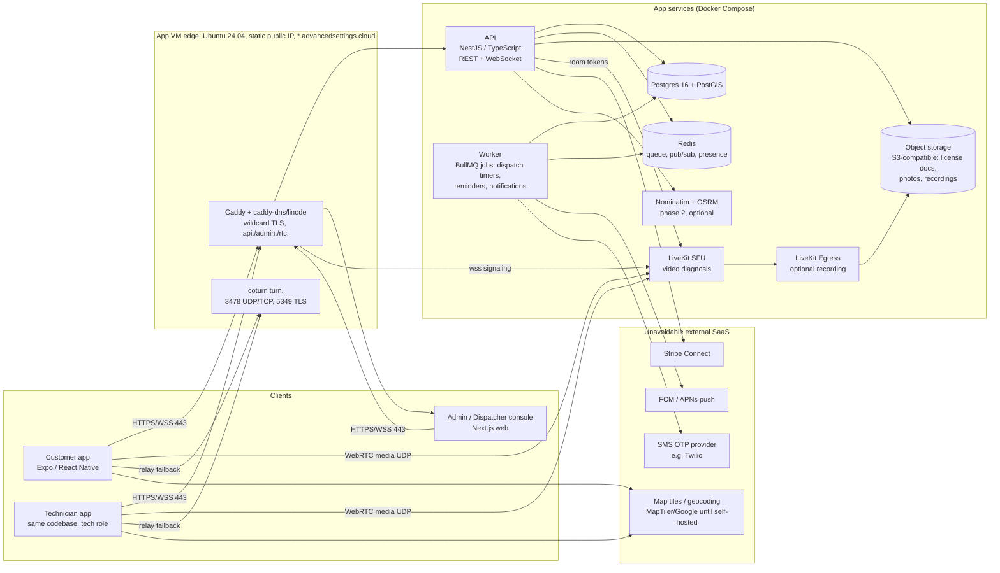
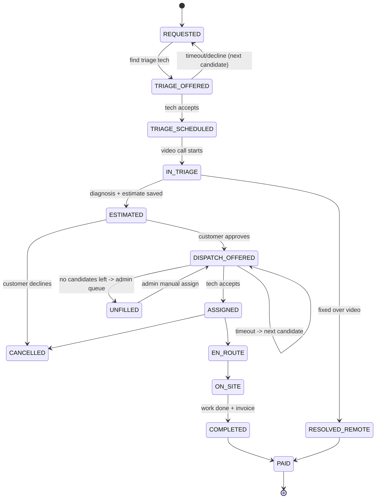

# Trades Dispatch: Architecture & MVP Build Plan

**Owner:** James Foley, Advanced Settings LLC
**Status:** Draft v0.2 (2026-10-18): updated with domain, DNS, network, and hosting decisions
**Domain:** `advancedsettings.cloud` (api. / admin. / rtc. / turn.), DNS on Linode, wildcard TLS via Caddy DNS-01
**Working name:** "Trades Dispatch" (placeholder)

> An "Uber for licensed trades." A homeowner requests a small house call. A licensed tech diagnoses it over video first, then the platform dispatches a nearby, **verified, licensed** plumber, electrician, or HVAC tech. Everything runs self-hosted on a new Ubuntu 24.04 VM in James's home cluster (static public IP block), designed to grow to multiple nodes later and portable to a Linode instance.

---

## 0. Product principles (from the competitor research)

| Lesson / pain point | Design response |
|---|---|
| Thumbtack/Angi sell **shared, pay-per-lead** leads with opaque pricing | **Exclusive dispatch.** One job goes to one pro at a time. No lead fees. A **flat, published** platform fee. |
| Pros leave platforms over % commissions ("Uber for plumbers" post-mortems) | Flat per-job fee (or monthly seat), never a % of the repair. Pros keep their own pricing on the repair itself. |
| Speed matters on only ~10% of jobs | Support **both** modes: *Emergency* (dispatch now, surge-free flat call-out) and *Scheduled* (pick a window). Don't build the whole product around a 30-minute ETA. |
| Platform leakage after the first job | Give both sides reasons to stay: job history, a workmanship guarantee only on platform jobs, invoicing and payments for the pro, repeat-booking "my pro" button. Don't fight leakage with contract clauses alone. |
| Handyman apps blur licensed vs unlicensed work | **License verification is a core feature.** A pro can't receive a job in a trade without a verified, unexpired license and insurance on file. |
| Frontdoor's video diagnosis works | **Diagnose first.** Video triage sets scope, parts, and price range before a truck rolls. |
| Puls is the closest dispatch competitor; mountain towns are underserved | Launch hyper-local (Eagle County / I-70 corridor) where the national apps are thin. Recruit local shops, not gig workers. |
| Homejoy/HomeHero died partly over worker classification | Pros are **independent licensed businesses** (shops or sole proprietors) that set their own prices and accept/decline freely. Get a Colorado employment attorney to review this before launch. |

---

## 1. System overview



**Request lifecycle (happy path):**
1. Customer opens app → picks trade + describes problem + photos + address.
2. API geocodes the address, creates `job` (state `REQUESTED`), takes a card **authorization** for the diagnostic fee.
3. Dispatch engine offers a **video triage** slot to an available licensed tech in that trade (can be a remote-only "triage tech" or the field tech).
4. Video call (LiveKit) → tech records diagnosis, scope, rough price range, parts.
5. Customer approves → dispatch engine offers the **on-site job** to the best nearby field tech → accept → live ETA/location → on-site → complete → invoice → payout via Stripe Connect.

---

## 2. Mobile app + admin console

**Pick: Expo (React Native) + TypeScript, one app with two roles; Next.js admin console in the same monorepo.**

Why Expo over Flutter here:
- **One language end to end** (TypeScript): mobile, admin web, and API share types, validation schemas (zod), and API client. Much less surface area for one developer.
- **LiveKit has a first-class React Native SDK** (`@livekit/react-native` + Expo config plugin). Needs an Expo **dev build** (not Expo Go) because of native WebRTC; that's fine.
- **EAS Build** produces iOS builds without owning a Mac for every build (EAS is SaaS; you can also build locally on a Mac with `eas build --local`).
- Mature libs for maps (`react-native-maps` / MapLibre RN), background location (`expo-location` + task manager), push (`expo-notifications`), camera/photos.
- Flutter would also work (good performance, LiveKit Flutter SDK exists), but it adds Dart and makes it harder to share code with the web admin and API.

**Roles (same binary, role from the auth token):**

| Customer | Technician | Admin / Dispatcher (web) |
|---|---|---|
| Sign up (phone OTP) | Onboarding: business info, trades, license #s, insurance COI upload, service area polygon/radius | License/insurance review queue (approve/reject/expire) |
| Request job: trade, problem, photos, address, emergency vs scheduled | Online/offline toggle, availability windows | Live dispatch board (map + job states) |
| Join video triage | Incoming offers (accept/decline with countdown) | Manual assign / reassign / cancel |
| Approve estimate, track tech on map, chat | Video triage, write diagnosis + estimate | Pricing config (fees per trade/zone) |
| Pay, rate, rebook "my pro" | Navigate (hand off to Apple/Google Maps), status updates, photos, invoice | Disputes, refunds, user bans |
| Job history, receipts | Earnings, payouts (Stripe Express dashboard) | Audit log, reports |

Admin console: **Next.js (App Router) + Tailwind + shadcn/ui**, MapLibre GL JS for the dispatch map. Served from the app VM behind Caddy at `admin.advancedsettings.cloud`, restricted by role and optionally by IP/VPN (Tailscale/WireGuard) for MVP.

---

## 3. Backend

**Pick: Node.js 22 + NestJS (TypeScript), Postgres 16 + PostGIS, Redis 7, BullMQ, Socket.IO.**

| Concern | Choice | Notes |
|---|---|---|
| API framework | **NestJS** (Fastify adapter) | Modules map cleanly onto domains (auth, jobs, dispatch, licensing, payments, video). OpenAPI generation for the mobile client. |
| DB access | **Kysely** (typed SQL) + raw SQL for PostGIS | Prisma handles PostGIS poorly; Kysely keeps typed queries without fighting geography types. Migrations via Kysely migrator or `dbmate`. |
| Database | **Postgres 16 + PostGIS 3.4** (`postgis/postgis:16-3.4`) | `geography(Point,4326)` for tech locations and job addresses; `geography(Polygon)` for service areas; GiST indexes. |
| Cache / presence | **Redis 7** | Tech online presence + last location (`GEOADD` for hot path), rate limits, Socket.IO adapter. |
| Job queue | **BullMQ** (on Redis) | Offer timeouts, re-dispatch, license-expiry reminders, notification fan-out, Stripe webhook processing. Delayed jobs = offer countdowns. |
| Real-time | **Socket.IO** with Redis adapter | Rooms per job (`job:{id}`) for status + tech location; per-user rooms for offers. Redis adapter lets you run several API replicas later. |
| Auth | Phone OTP → short-lived JWT access + rotating refresh token | Self-built in NestJS (simple) or self-hosted **Keycloak/Zitadel** if you want SSO for admin later. SMS delivery is external (Twilio/Telnyx). |
| Object storage | **S3-compatible**: MinIO, or Garage/SeaweedFS | License PDFs, COIs, job photos, recordings. Note MinIO changed its community distribution/console in 2025; verify the current state before picking, Garage is a lightweight alternative. All access via presigned URLs. |
| Observability | pino JSON logs → Loki; `/metrics` → Prometheus | See §9. |

**Core tables (sketch):**

```
users(id, role[customer|tech|admin], phone, email, name, created_at)
tech_profiles(user_id, business_name, stripe_account_id, status[pending|active|suspended],
              service_area geography(Polygon), max_radius_m, rating, jobs_completed)
tech_trades(tech_id, trade[plumbing|electrical|hvac], level[apprentice|journeyman|master|contractor])
licenses(id, tech_id, trade, jurisdiction[CO-state|town-of-vail|eagle-county|...], license_no,
         license_class, expires_on, status[pending|verified|rejected|expired],
         verified_by, verified_at, evidence_url, source_url)
insurance_docs(id, tech_id, type[GL|WC], carrier, policy_no, coverage_amount, expires_on, status, doc_key)
tech_presence(tech_id, online, location geography(Point), heading, updated_at)  -- also mirrored in Redis
jobs(id, customer_id, trade, mode[emergency|scheduled], window_start, window_end,
     address, location geography(Point), description, state, assigned_tech_id,
     diagnostic_fee_cents, platform_fee_cents, estimate_low_cents, estimate_high_cents, created_at)
job_events(id, job_id, from_state, to_state, actor_id, payload jsonb, at)   -- append-only audit
offers(id, job_id, tech_id, kind[triage|onsite], status[pending|accepted|declined|expired],
       sent_at, expires_at, distance_m, eta_s)
video_sessions(id, job_id, livekit_room, started_at, ended_at, recorded bool, consent_at, recording_key)
payments(id, job_id, stripe_payment_intent, amount_cents, kind[diagnostic|repair|platform_fee], status)
reviews(id, job_id, rater_id, ratee_id, stars, text)
```

---

## 4. Video diagnosis

**Pick: LiveKit (self-hosted SFU) + coturn, recording via LiveKit Egress (optional, off by default).**

Why LiveKit over Jitsi: an API built for embedding (server SDK mints room tokens from the NestJS API), solid React Native and web SDKs, simulcast, and a clean webhook model (room started/ended, participant joined). Jitsi is great for meetings-in-a-browser but is heavier to embed in a native app.

- **Flow:** API creates the room `job-{id}-triage`, mints a short-lived token for the customer and the assigned tech (grants: join that room only, ~1h TTL). The app connects to `wss://rtc.<domain>`.
- **Network:** LiveKit signaling over WSS at `rtc.advancedsettings.cloud` (443 via Caddy). Media on **UDP 50000–50999** (narrowed range) with **TCP 7881** as fallback. LiveKit advertises the static public IP (`use_external_ip: false`, `NODE_IP`). **coturn** at `turn.advancedsettings.cloud`: 3478 UDP/TCP and 5349 TLS (wildcard cert), optionally 443/TLS on a second public IP, for customers behind strict NAT or corporate networks. LiveKit's embedded TURN is off. LiveKit hands clients time-limited coturn credentials via `rtc.turn_servers` + shared secret. Details in §9.
- **Bandwidth (1:1 call):** ~1–2.5 Mbps each direction per participant at 720p, ~0.5 Mbps at 360p. The SFU forwards each stream, so **server upload ≈ sum of what all participants download**. Rule of thumb: **~3–4 Mbps upstream per concurrent call** at 720p. 10 concurrent calls ≈ 30–40 Mbps **upload from the house**. Cap publish at 720p/30 and enable adaptive stream + dynacast. Rear-camera "show me the leak" works fine at 540p.
- **Recording + consent:**
  - Off by default. Turn on only with an **explicit in-app consent toggle from both parties**, logged in `video_sessions.consent_at` and shown on screen ("Recording" badge).
  - Colorado is generally a one-party-consent state for recording, but customers may be elsewhere and the call happens inside their home, so **use all-party consent always** (to verify with counsel).
  - Prefer **track egress** (saves raw tracks, no transcoding, low CPU) over room-composite egress (headless Chrome, 2–4 cores per recording).
  - Retention: e.g. 90 days, then auto-delete via S3 lifecycle unless a dispute is flagged. Encrypt at rest.
- **Fallback:** if WebRTC fails, offer "send a 30-second video" (upload to S3) so triage can be async.

---

## 5. Dispatch engine

### Job state machine



Every transition goes into `job_events` (append-only) and is published to `job:{id}` over Socket.IO. Transitions live in one `JobStateService` with guarded transitions. No ad-hoc state writes.

### Matching (hard filters → score)

**Hard filters (SQL):**
1. Tech `status = active`, Stripe account `charges_enabled`.
2. Has `tech_trades.trade = job.trade` **and** a `licenses` row for that trade with `status = verified`, `expires_on > job date`, and a jurisdiction valid for the job location (state license for plumbing/electrical; local license where HVAC requires it).
3. Valid GL insurance on file, not expired.
4. Job location inside the tech's `service_area` polygon (or within `max_radius_m`).
5. Emergency: tech `online` and last ping < 2 min. Scheduled: tech availability overlaps the window.
6. Not already declined or expired for this job; not blocked by the customer.

**Score (app code):**
`score = w1·(1/eta) + w2·rating + w3·acceptance_rate + w4·fairness(time since last offer) + w5·repeat_customer_bonus`
- ETA: straight-line distance × mountain-road factor (~1.4) for MVP; **OSRM** road ETA in phase 2. In the mountains straight-line is badly wrong (passes, I-70 closures), so OSRM is worth it early.
- "My pro" repeat booking: offer to that pro first (anti-leakage: keeps repeat business on-platform).

**Offers:**
- **Sequential exclusive offers** (one tech at a time) with a BullMQ delayed job as the timer: **emergency 60–90 s**, **scheduled 15–30 min** (or batch-notify the top 3 for scheduled, first to accept wins via `SELECT ... FOR UPDATE` / Redis lock).
- After N timeouts (e.g. 5) or no candidates left → `UNFILLED` → admin dispatcher alert (push + SMS to James).
- Acceptance and decline rates feed the score. Repeated no-response → auto-offline the tech.

**Emergency vs scheduled:**
| | Emergency | Scheduled |
|---|---|---|
| Triage | Optional (can skip to dispatch if obvious, e.g. burst pipe, no heat at −10°F) | Required, video first |
| Offer window | 60–90 s, sequential | 15–30 min, batch of 3 |
| Pricing | Published flat emergency call-out fee | Standard diagnostic fee |
| ETA | Live, from tech location stream | Arrival window |

**Live location:** the tech app sends location every 10–15 s while `EN_ROUTE` (background location), the API writes it to Redis GEO + throttled to Postgres, and fans it out to `job:{id}`. Stop tracking at `ON_SITE` (privacy).

---

## 6. License & insurance verification

**MVP = manual admin review with assisted lookup links. No scraping, no fully automated verification.**

Workflow:
1. Tech enters **license number, class, jurisdiction, expiration**, uploads a photo/PDF of the license card and a **Certificate of Insurance** (GL; workers' comp if they have employees).
2. Admin console shows a review card with a **deep link to the official lookup** for that jurisdiction pre-filled where possible.
   - Colorado DORA license lookup (plumbers + electricians, **state-level** via the State Plumbing Board and State Electrical Board): `https://apps2.colorado.gov/dora/licensing/Lookup/LicenseLookup.aspx` *(verify URL)*.
   - **HVAC / mechanical: no statewide CO license (to verify).** Licensing is by city/county building departments (e.g. Town of Vail, Eagle County, Avon, Edwards area). Keep a `jurisdictions` table with the lookup URL / contact per jurisdiction. EPA Section 608 certification is federal and applies to refrigerant handling; capture it too.
3. Admin compares name, number, class, status, expiry → **Approve / Reject (reason)**. Store `verified_by`, `verified_at`, a screenshot/PDF of the lookup result as evidence (`evidence_url`), and `source_url`.
4. **Expiry automation (BullMQ cron, daily):** reminders to the tech at 60/30/7 days before expiry; on expiry → license `expired` → tech is automatically removed from matching for that trade, admin notified. Same for insurance.
5. **Re-verify** on a schedule (e.g. every 90 days) by putting the license back in the review queue, since licenses can be suspended mid-term.
6. Customer-facing **"Licensed & Insured" badge** shows trade, license class, jurisdiction, and the verified date (not the raw number unless the tech opts in; to verify whether CO requires showing it).
7. **Apprentices:** CO lets registered apprentices work under supervision. MVP: only licensed journeyman/master/contractor accounts can accept jobs; apprentices can be added later as crew under a supervising license.

Phase 3: per-jurisdiction automated checks where an official API/bulk data exists (Colorado publishes some licensing data sets; verify terms).

**Background checks:** optional at MVP (shops vouch for their own employees); phase 2 via Checkr (SaaS, FCRA-compliant). Requires FCRA disclosure + consent flows.

---

## 7. Payments & pricing

**Stripe Connect (Express accounts) is the realistic exception to on-prem.** Don't self-host card processing (PCI scope). Nothing card-related is stored on the box, only Stripe IDs.

- Techs onboard via Stripe-hosted Express onboarding (KYC, bank, 1099-K handled by Stripe).
- **Diagnostic/triage fee:** PaymentIntent with `capture_method=manual` at request time → captured when the triage call happens (released if no one is found).
- **Repair invoice:** the tech enters line items in the app → customer approves → charge with a **destination charge** to the tech's connected account, platform keeps `application_fee_amount` = flat platform fee.
- Webhooks → API `/webhooks/stripe` → BullMQ (idempotent processing).

**Pricing model options (pick one for launch):**

| Option | How it works | Pros | Cons |
|---|---|---|---|
| **A. Flat diagnostic + flat platform fee (recommended)** | Customer pays e.g. $49–89 video diagnostic (credited toward the repair if they book). Platform takes a flat **$X per completed job** (e.g. $15–25) from the pro, published. | Transparent, no % commission, matches the positioning | Platform revenue doesn't scale with big jobs |
| B. Pro subscription | Pros pay $X/month per seat, $0 per job | Very predictable, zero per-job friction, kills the incentive to leak | Hard to sell before there's volume |
| C. Hybrid | Low monthly fee + small flat per-job fee | Balanced | More to explain |
| D. % commission (Puls/Angi-like) | 10–20% of the job | Scales with ticket size | Exactly what makes pros leave. **Avoid.** |

Customer-side: show the **price range from triage before dispatch**, the diagnostic fee up front, and an emergency call-out fee if applicable. No hidden fees.

---

## 8. Push, SMS, maps, geocoding

**Unavoidable external dependencies:**
- **Push:** APNs (iOS) and FCM (Android). Use Expo's push service for MVP (simplest), or send directly to FCM/APNs from the worker for fewer middlemen. Offers must arrive fast: use high-priority / time-sensitive notifications, plus an **SMS fallback** for emergency offers not opened within 30 s.
- **SMS OTP:** Twilio/Telnyx (needs A2P 10DLC registration for US SMS).
- **App store distribution:** Apple Developer ($99/yr), Google Play ($25 one-time).

**Maps/geocoding: start hosted, self-host in phase 2.**

| Need | MVP (hosted, cheap) | Self-hosted (phase 2+) |
|---|---|---|
| Address autocomplete / geocode | Google Places or MapTiler/Mapbox geocoding | **Nominatim** (Colorado-only extract: small and fast) + **Photon** for autocomplete |
| Routing / ETA | Straight-line × factor, or Google Distance Matrix (paid per call) | **OSRM** or **Valhalla** with a Colorado OSM extract (~few GB RAM) |
| Map tiles in apps | MapTiler free tier / Google Maps SDK | **OpenMapTiles/Protomaps PMTiles** served from the box + **MapLibre** in RN and web |
| Turn-by-turn nav for techs | Hand off to Apple/Google Maps via deep link | Same, don't build nav |

Mountain addresses (rural routes, unit numbers, gated communities) geocode poorly on OSM. Keep a "drop a pin" option and let the customer correct the pin. That matters more than which geocoder you pick.

---

## 9. On-prem deployment

**Decided:** build on-prem first. A **new Ubuntu 24.04 LTS VM** in James's home cluster, next to the existing Docker sandbox VM. The hypervisor host is at `10.225.30.2` (hypervisor type and VM IP TBD). Domain **`advancedsettings.cloud`**, DNS on **Linode**, **static public IP block** available. Step-by-step: [`DEPLOY.md`](DEPLOY.md).

### Topology
- **MVP:** one VM (`trades-app`) running **Docker Engine + Compose v2** (`docker-compose.yml`). Keep it separate from the sandbox VM: prod-ish data shouldn't share a VM with experiments.
- **Network placement:** put the VM on its own VLAN/DMZ segment if possible, with no route from it into the home LAN or the hypervisor management network (10.225.30.2) except what you explicitly allow (e.g. SSH from your admin subnet or VPN).
- **Later (multi-node):** **k3s** across cluster VMs. The services are already stateless (API, worker, admin) or have clear state (Postgres, Redis, object storage). Postgres → CloudNativePG; LiveKit → multiple nodes sharing Redis (already configured); Socket.IO → Redis adapter.
- **Future option: move to Linode.** The same Compose stack runs unchanged on a Linode instance (Ubuntu 24.04, 4–8 GB plan to start). Differences: the public IP sits directly on the instance (no NAT, so `APP_LAN_IP` = `APP_PUBLIC_IP` = the Linode IP, coturn `--external-ip` = that IP), and use a Linode Cloud Firewall with the same port table. Cutover = restore Postgres (pgBackRest/pg_dump) + object storage, then repoint the A records (low TTL makes this quick). DNS is already on Linode, so the DNS-01 setup carries over as-is. A Linode also works as a TURN/media edge or DR site if home internet becomes the bottleneck.

### Public IP plan (static block)
| Option | How | Pros / cons |
|---|---|---|
| **A. 1:1 NAT (recommended to start)** | Edge router/firewall maps `APP_PUBLIC_IP` ↔ `APP_LAN_IP` (VM's private IP) for **inbound and outbound** (outbound SNAT must use the same public IP, or WebRTC/TURN break). Only allow the ports below. | Works with any hypervisor network; the VM stays on private addressing. You need the 1:1 mapping, not just per-port forwards, for symmetric media paths. |
| B. Routed | Route the public IP (or a /29 subnet) to the VM; it holds the public IP on its NIC (or a second vNIC). | No NAT quirks for WebRTC; firewalling is then 100% the edge firewall + ufw. Needs the ISP to route the block to your router. |

- **Optional second public IP for coturn (`TURN_PUBLIC_IP`)**: give the VM a secondary private IP (`TURN_LAN_IP`, via netplan), 1:1 NAT the second public IP to it, and run coturn bound only to that IP with **TURN/TLS on 443**. Some hotel, corporate, and carrier networks only allow 443, so this pushes connection success close to 100%. Caddy already binds 80/443 only to `APP_LAN_IP`, so there's no conflict. For MVP, one IP with coturn on 3478/5349 is fine.
- `PUBLIC_IP`/`LAN_IP` placeholders live in `.env` (`APP_PUBLIC_IP`, `APP_LAN_IP`, `TURN_PUBLIC_IP`, `TURN_LAN_IP`).
- **Hairpin:** phones on the home Wi-Fi testing `api.advancedsettings.cloud` need NAT reflection on the edge, or split-horizon DNS on the internal resolver pointing the names at the private IP. Note: split DNS breaks WebRTC media from the LAN because LiveKit advertises the public IP, so NAT reflection is the better option. Better still: test from cellular.

### DNS records (Linode DNS Manager, zone `advancedsettings.cloud`)
Domain must be delegated to `ns1–ns5.linode.com` at the registrar.

| Name | Type | Value | TTL | Notes |
|---|---|---|---|---|
| `api` | A | `APP_PUBLIC_IP` | 300 | API + WebSocket |
| `admin` | A | `APP_PUBLIC_IP` | 300 | Admin console (Caddy allows LAN/VPN only) |
| `rtc` | A | `APP_PUBLIC_IP` | 300 | LiveKit signaling (WSS via Caddy); media goes to the same IP |
| `turn` | A | `TURN_PUBLIC_IP` (= `APP_PUBLIC_IP` if single IP) | 300 | coturn, served directly, not via Caddy |
| `*` (optional) | A | `APP_PUBLIC_IP` | 300 | Only if you want new subdomains without DNS edits. Explicit records are preferred: `turn` must be explicit if it uses a separate IP. |
| `@` | CAA | `0 issue "letsencrypt.org"` | 3600 | Optional hardening: only Let's Encrypt may issue |
| `_acme-challenge` | TXT | (managed by Caddy) | 30 s | Created/removed automatically during DNS-01. Don't create it by hand. |

TTL: **300 s** during build-out and any future cutover (e.g. to Linode); raise to 3600 once stable. Add AAAA records only once the VM has working IPv6 end to end (LiveKit/coturn included).

### Reverse proxy & wildcard TLS
- **Caddy built with `github.com/caddy-dns/linode`** (`infra/caddy/Dockerfile`, xcaddy multi-stage). Compose builds it as the `caddy` service.
- **One wildcard site block** `*.advancedsettings.cloud` (`infra/caddy/Caddyfile`) with `tls { dns linode {env.LINODE_DNS_API_TOKEN} }` → a single Let's Encrypt **wildcard cert** via **DNS-01**. Port 80 isn't needed for ACME (still published for HTTP→HTTPS redirects). Host matchers route:
  - `api.advancedsettings.cloud` → `api:3000` (REST + Socket.IO)
  - `admin.advancedsettings.cloud` → `admin:3001`, **LAN/VPN only** (`private_ranges` + `100.64.0.0/10` for Tailscale), everyone else gets 403
  - `rtc.advancedsettings.cloud` → `host.docker.internal:7880` (LiveKit on host network)
  - anything else → `abort`
- Linode DNS propagation is slow, so the Caddyfile uses the plugin README's settings (`propagation_delay 2m`, `propagation_timeout -1`, `dns_ttl 30s`). The first issuance takes about 2–3 minutes.
- **Linode token:** Personal Access Token with **Domains: Read/Write only**, everything else No Access, with an expiry. Linode PATs cover every domain on the account, so ideally create it under a **restricted Linode user** whose only grant is read/write on `advancedsettings.cloud`. It goes in `.env` as `LINODE_DNS_API_TOKEN`.
- The wildcard doesn't cover the apex (`advancedsettings.cloud`); add it as a second site address if a landing page is ever served there.

### Sharing the wildcard cert with coturn (turns:5349 / 443) and LiveKit
- Caddy stores the cert in the `caddy_data` volume:
  `/data/caddy/certificates/acme-v02.api.letsencrypt.org-directory/wildcard_.advancedsettings.cloud/wildcard_.advancedsettings.cloud.{crt,key}`
- **Chosen approach: export script.** `infra/scripts/export-certs.sh` copies the pair out read-only (via a throwaway alpine container), writes `infra/coturn/certs/fullchain.pem` + `privkey.pem` owned by coturn's UID (nobody/65534, `0600` key), and **restarts coturn only when the cert changed**. Run it daily from a systemd timer (DEPLOY.md). Caddy renews about 30 days before expiry, so there's plenty of margin.
- Alternative: mount `caddy_data` read-only into coturn and point `cert=`/`pkey=` at the `wildcard_` files. Simpler, but Caddy writes the key `0600 root`, so coturn would have to run as root, and it still needs a restart after renewal. Not recommended.
- **LiveKit doesn't need the cert:** signaling TLS terminates at Caddy (`rtc.`), and media is DTLS-SRTP with self-generated certs. LiveKit's embedded TURN is **disabled**. Instead `rtc.turn_servers` lists coturn (`turn.advancedsettings.cloud` 5349/tls and 3478/udp, plus 443/tls if the second IP is used) with `secret_file`, so **LiveKit mints time-limited TURN credentials** for clients from the same shared secret coturn uses (`use-auth-secret`). Only if you switch to LiveKit's embedded TURN would you set `turn.domain: turn.advancedsettings.cloud` and give it the exported cert.
- **LiveKit IP:** `use_external_ip: false`, node IP from `NODE_IP=${APP_PUBLIC_IP}` (the `--node-ip` flag). No STUN discovery, so the advertised candidate is always the static public IP.

### Ports: edge firewall / 1:1 NAT and ufw
Allow only these inbound to the app VM. With 1:1 NAT, the edge firewall must still filter. Don't forward "all ports".

| Port(s) | Proto | Public IP | Service | Notes |
|---|---|---|---|---|
| 80 | TCP | APP | Caddy | HTTP→HTTPS redirect (ACME uses DNS-01, so optional) |
| 443 | TCP + UDP | APP | Caddy | HTTPS + HTTP/3: api., admin., rtc. signaling |
| 7881 | TCP | APP | LiveKit | ICE/TCP fallback |
| **50000–50999** | UDP | APP | LiveKit | WebRTC media. Narrowed from LiveKit's default 50000–60000 (≈500 participants). Must match `livekit.yaml`. |
| 3478 | UDP + TCP | TURN | coturn | STUN/TURN |
| 5349 | TCP | TURN | coturn | TURN over TLS (wildcard cert) |
| 443 | TCP | TURN (2nd IP only) | coturn | TURN/TLS on 443, only with a dedicated TURN IP |
| 49160–49200 | UDP | TURN | coturn | TURN relay range (`min-port`/`max-port`). Required for relayed calls. |
| 22 | TCP | — | SSH | **LAN/VPN only**, never forwarded |
| 7880, 3000, 3001, 5432, 6379, 9000/9001 | TCP | — | internal | **Never public.** 7880 is reachable only from Docker bridges (for Caddy/API). |

**Docker + ufw gotcha:** Docker inserts its own iptables rules, so **published container ports (Caddy 80/443) bypass ufw** (they go through FORWARD → `DOCKER-USER`, not INPUT). The rest of this design handles that:
- Internal services publish on `127.0.0.1` only; Caddy binds to `APP_LAN_IP` only.
- LiveKit and coturn use **host networking**, so they *are* governed by ufw INPUT rules (below).
- Lock down `DOCKER-USER` so only 80/443 reach containers from the outside NIC. Append to `/etc/ufw/after.rules` (replace `ens18` with the VM's NIC), then `sudo ufw reload`:

```
# --- Docker: only allow 80/443 from the outside NIC to published containers ---
*filter
:DOCKER-USER - [0:0]
-A DOCKER-USER -m conntrack --ctstate RELATED,ESTABLISHED -j RETURN
-A DOCKER-USER ! -i ens18 -j RETURN
-A DOCKER-USER -i ens18 -p tcp -m conntrack --ctorigdstport 80  --ctdir ORIGINAL -j RETURN
-A DOCKER-USER -i ens18 -p tcp -m conntrack --ctorigdstport 443 --ctdir ORIGINAL -j RETURN
-A DOCKER-USER -i ens18 -p udp -m conntrack --ctorigdstport 443 --ctdir ORIGINAL -j RETURN
-A DOCKER-USER -i ens18 -j DROP
COMMIT
```
(`--ctorigdstport` matches the pre-DNAT port. Or use the `ufw-docker` helper, which does the same thing.)

**ufw (host-network services + SSH):**
```bash
sudo ufw default deny incoming && sudo ufw default allow outgoing
sudo ufw allow from <ADMIN_SUBNET_OR_VPN> to any port 22 proto tcp
sudo ufw allow 7881/tcp
sudo ufw allow 50000:50999/udp
sudo ufw allow 3478 && sudo ufw allow 5349/tcp
sudo ufw allow 49160:49200/udp
sudo ufw allow from 172.16.0.0/12 to any port 7880 proto tcp   # Caddy/API containers -> LiveKit on host
# (80/443 for Caddy are handled by DOCKER-USER above; ufw rules for them are harmless but don't apply)
sudo ufw enable
```
Add fail2ban for SSH and turn on `unattended-upgrades`. Mirror the same port list in the edge firewall.

### Backups (3-2-1)
- **Postgres:** nightly `pg_dump -Fc` + continuous WAL archiving with **pgBackRest** or **WAL-G** → local backup disk + offsite (Backblaze B2 / Wasabi / a second site, encrypted). Test a restore monthly.
- **Object storage (docs, photos, recordings):** `restic` or `rclone` encrypted sync to offsite.
- **Config + secrets:** git repo (secrets encrypted with **SOPS + age**), plus a restic snapshot of `/opt/trades-dispatch`.
- Redis: treat as cache/queue. AOF on, but nothing irreplaceable lives only there.
- **RPO target 15 min (WAL), RTO target 4 h** for MVP. A UPS plus an auto-shutdown hook (NUT) on the hypervisor is non-negotiable for a home-hosted production DB. Also snapshot the VM at the hypervisor level before upgrades, but don't rely on snapshots alone for Postgres consistency.

### Monitoring
- **Uptime Kuma**: external checks of api/admin/rtc + TURN (run a second instance off-site, or use a free external pinger, because a home outage takes the monitor down too). Alerts via push, SMS, or email.
- **Prometheus + Grafana + node_exporter + cAdvisor + postgres_exporter**; LiveKit exposes Prometheus metrics (rooms, packet loss, bandwidth).
- **Loki + Promtail/Alloy** for logs. **Sentry** (self-hosted is heavy; use GlitchTip as a lighter self-hosted option) for app crash reports.
- Business alerts from the worker: `UNFILLED` jobs, offer timeouts spiking, license expiries.

### Secrets
- `.env` per environment, **never committed**; `.env.example` in git. Encrypt real values with **SOPS + age** in the repo, decrypt at deploy.
- Compose `secrets:` for DB password / Stripe keys where images support `*_FILE`. Move to k3s Secrets + Sealed Secrets (or Vault/OpenBao) on the cluster.
- Separate Stripe **test** vs **live** keys; LiveKit API key/secret; TURN shared secret (`use-auth-secret`; LiveKit mints time-limited credentials from it via `secret_file`, **not** static TURN users); `LINODE_DNS_API_TOKEN` (Domains read/write only, expiring, rotate).

---

## 10. Hardware sizing (app VM, MVP)

Assumptions: launch region, < 50 techs, < 200 jobs/day, ≤ 10 concurrent video calls, no composite recording. The figures below are the **VM allocation** (vCPU/RAM/disk) on the cluster host. The host also needs headroom for the sandbox VM. Start the VM at **4 vCPU / 16 GB / 200 GB** for build-out and grow it to the recommended size before launch.

| Resource | Minimum | Recommended | Notes |
|---|---|---|---|
| CPU | 4 cores / 8 threads (modern x86-64) | **8 cores / 16 threads** (Ryzen 7 / i7 / Xeon E) | LiveKit SFU is light without transcoding; composite egress needs 2–4 cores per recording. |
| RAM | 16 GB | **32 GB** | +8–16 GB if self-hosting Nominatim/OSRM (a Colorado extract is modest; all of the US is not). |
| Storage | 500 GB NVMe | **1 TB NVMe (OS + DB + apps)** + **separate 2–4 TB disk** for backups/recordings | Mirror the NVMe (ZFS or mdadm RAID1) if you can. |
| Network | 1 GbE | 1 GbE + **≥ 50 Mbps symmetric upload** from the ISP | **Upload bandwidth is the real bottleneck** for video (≈3–4 Mbps per concurrent call). Cable plans with 10–20 Mbps upload cap out at ~3–5 calls. |
| Power | UPS | UPS ≥ 30 min + NUT auto-shutdown | |
| Remote access | — | IPMI/iDRAC/iLO or a PiKVM | Lets you recover from Vail without driving home. |

Put VM disks on SSD/NVMe-backed storage (not shared spinning disks), and back up to a different physical disk than the VM's datastore. Upload bandwidth on the static-IP circuit is still the limit for concurrent video calls.

---

## 11. Security & compliance basics

- **PII inventory:** names, phones, home addresses, live tech location, photos/video inside homes, license numbers, insurance docs, payout info (held by Stripe, not us).
- **Encryption:** TLS everywhere (Caddy), encrypted disks (LUKS) on the VM and backup drives, encrypted offsite backups (restic). Object storage private, presigned URLs only (≤ 15 min).
- **Access control:** RBAC (customer/tech/admin) enforced in the API, not just the UI. Admin console behind SSO/MFA + VPN (Tailscale/WireGuard) for MVP. Audit log for every admin action and every view of license docs or recordings.
- **Location privacy:** collect tech location only while online/en route; show the customer the tech's location only for the active job; customer address is revealed to the tech only after accept. Retention: raw location points 30 days.
- **Video:** recording opt-in by all parties, visible indicator, retention limit, deletion on request. Don't use recordings for training/marketing without separate consent.
- **Colorado Privacy Act (CPA):** applies above certain thresholds (e.g. 100k consumers/yr), so probably not at launch, but build data export/delete endpoints from day one (cheap now, expensive later). Publish a privacy policy + terms (attorney).
- **Background checks:** FCRA disclosure/authorization flow if using Checkr. Store only the pass/fail result + report ID, not the report.
- **Worker classification:** contract with **businesses** (license holders/shops). They set prices, can decline any offer, use their own tools/vehicles. Have an attorney review the tech agreement.
- **Liability:** platform GL / tech E&O insurance for a marketplace; the pro's own GL is required (verified in §6). A clear "platform vs pro responsibility" section in the terms.
- **App security:** OWASP ASVS L1 basics, rate limiting (Redis), input validation (zod), dependency scanning (Renovate + `npm audit`/Trivy on images), Stripe webhook signature verification, LiveKit tokens scoped to one room with a short TTL, TURN credentials time-limited.
- **Ops security:** SSH keys only, no root login, fail2ban, unattended-upgrades, the app VM on an isolated VLAN, no DB/Redis ports exposed, image pinning by digest for prod.

---

## 12. Phased MVP roadmap

Assumes one main developer plus AI-assisted coding; durations are rough.

### Phase 0: Foundations (1–2 weeks)
- [ ] Answer the remaining open questions (§14). Domain, DNS, static IPs, and on-prem-first are decided.
- [ ] App VM provisioned per DEPLOY.md: Ubuntu 24.04, Docker, ufw + DOCKER-USER, its own VLAN, backup disk. Pick the public IP(s) from the block and set up 1:1 NAT.
- [ ] Linode DNS: A records for api/admin/rtc/turn (TTL 300), a restricted DNS token, wildcard cert issued by Caddy.
- [ ] Monorepo scaffold, CI (GitHub Actions or self-hosted Gitea/Forgejo + runner), `docker compose up` brings up the skeleton.
- [ ] Caddy wildcard TLS working on `api.`, `admin.`, `rtc.advancedsettings.cloud`. Cert exported to coturn. Trickle ICE shows `relay` candidates from `turn.`. A LiveKit test room works from a phone on LTE (proves NAT/TURN/ports).
- **Milestone:** a phone on cellular joins a LiveKit room hosted at home with good video.

### Phase 1: Concierge MVP (6–8 weeks): "video triage + manual dispatch"
- [ ] Auth (phone OTP), customer + tech roles.
- [ ] Tech onboarding + license/COI upload + **admin review queue** + expiry reminders.
- [ ] Customer job request (trade, photos, address with pin, emergency/scheduled).
- [ ] Video triage via LiveKit (no recording yet); tech writes diagnosis + estimate range.
- [ ] **Dispatcher (James/admin) assigns jobs manually** from the admin console; push notifications to techs; tech status updates (en route/on site/done).
- [ ] Stripe Connect Express onboarding; diagnostic fee hold/capture; repair invoice + flat platform fee.
- [ ] Ratings, job history, receipts.
- [ ] TestFlight + Play internal testing; 3–5 friendly licensed shops in Eagle County; 20–50 real jobs.
- **Milestone:** 20 paid jobs done end-to-end with verified licensed pros, and pros still happy with the flat fee.

### Phase 2: Automated dispatch (6–8 weeks)
- [ ] Matching engine (hard filters + scoring), sequential offers with timeouts, `UNFILLED` escalation.
- [ ] Live tech location + ETA on the customer map; OSRM (Colorado extract) for road ETAs.
- [ ] Scheduled windows + tech availability calendar; "my pro" rebooking.
- [ ] Optional consented recording (track egress → object storage, retention policy).
- [ ] SMS fallback for emergency offers; Prometheus/Grafana dashboards; offsite backups verified with a restore test.
- [ ] Public App Store / Play Store launch in the launch region.
- **Milestone:** median emergency offer-to-accept under 3 min with no human dispatcher; ≥ 80% of jobs auto-dispatched.

### Phase 3: Scale & moat (ongoing)
- [ ] Self-hosted geocoding/tiles (Nominatim/Photon/PMTiles) to cut map SaaS costs.
- [ ] Pro tools that reduce leakage: quotes, invoices, parts lists, customer CRM, warranty registry, maintenance plans (seasonal HVAC/furnace tune-ups: big in the mountains).
- [ ] Background checks (Checkr); workmanship guarantee program.
- [ ] Shop/crew accounts (owner + multiple techs + apprentices under supervision).
- [ ] Multi-node: k3s, CloudNativePG, LiveKit multi-node, or an off-site TURN/media edge.
- [ ] Expand along the I-70 corridor (Summit, Garfield, Grand counties), then other mountain markets.
- **Milestone:** platform survives losing one node; 3+ counties live.

---

## 13. Starter repo layout

```
trades-dispatch/
├── ARCHITECTURE.md
├── DEPLOY.md                     # VM build + deploy runbook
├── docker-compose.yml            # single-VM skeleton (this repo)
├── .env.example
├── secrets/                      # turn_secret etc. (gitignored)
├── apps/
│   ├── mobile/                   # Expo (React Native) app: customer + technician roles
│   │   ├── app/                  # expo-router screens: (customer)/, (tech)/, (auth)/
│   │   ├── src/{api,components,features,hooks,video,location}/
│   │   └── app.config.ts         # LiveKit + location + notifications config plugins
│   ├── admin/                    # Next.js dispatcher/admin console
│   │   └── src/app/{dispatch,jobs,techs,licenses,payments,settings}/
│   └── api/                      # NestJS API + worker (same image, different entrypoint)
│       ├── src/modules/
│       │   ├── auth/  users/  techs/  licensing/  insurance/
│       │   ├── jobs/  dispatch/  offers/  realtime/  video/
│       │   ├── payments/  notifications/  geo/  admin/  audit/
│       ├── src/worker.ts         # BullMQ processors (offer timeouts, reminders, webhooks)
│       ├── db/migrations/        # SQL migrations (PostGIS)
│       └── Dockerfile
├── packages/
│   ├── shared/                   # zod schemas, job state enum, API types
│   └── api-client/               # generated OpenAPI client for mobile + admin
├── infra/
│   ├── caddy/{Dockerfile,Caddyfile}   # xcaddy + caddy-dns/linode, wildcard site
│   ├── livekit/livekit.yaml
│   ├── coturn/{turnserver.conf,certs/} # certs/ filled by export-certs.sh
│   ├── scripts/export-certs.sh    # Caddy wildcard cert -> coturn
│   ├── monitoring/               # prometheus.yml, grafana dashboards, uptime-kuma (phase 1–2)
│   ├── backup/                   # pgbackrest/restic scripts + systemd timers
│   └── k3s/                      # future: manifests/helm values
└── docs/
    ├── runbooks/                 # restore DB, rotate secrets, VM rebuild
    └── jurisdictions.md          # license lookup sources per jurisdiction
```

Tooling: pnpm workspaces + Turborepo, TypeScript strict, ESLint/Prettier, Vitest/Jest, Playwright (admin), Maestro (mobile e2e).

The `docker-compose.yml` skeleton lives next to this doc, with `infra/` configs, `.env.example`, and `DEPLOY.md`. It is **not deployed**. Image tags are pinned to major versions; pin digests for prod.

---

## 14. Decisions & open questions

**Decided (2026-10-18):**
- Build **on-prem first**: a new Ubuntu 24.04 VM in the home cluster, next to the existing Docker sandbox VM (hypervisor at 10.225.30.2). Linode instance as a later or DR option.
- **Static public IP block**: a dedicated public IP for the app VM (1:1 NAT or routed), with an optional second IP for coturn on 443.
- Domain **`advancedsettings.cloud`** with `api.`, `admin.`, `rtc.`, `turn.`; **DNS on Linode**; **wildcard cert** `*.advancedsettings.cloud` via Caddy DNS-01 (caddy-dns/linode).
- Plain **Docker Compose** on the VM for MVP (k3s later).

**Still open (only James can answer):**
1. **Hypervisor** (Proxmox, ESXi, Hyper-V, XCP-ng?) and the **VM's private IP** / VLAN. How much CPU/RAM/disk can the host give the app VM next to the sandbox VM?
2. **Which public IP(s)** from the block, and **1:1 NAT or routed**? What edge router/firewall does the NAT? Does it support NAT reflection?
3. **Second public IP for coturn on 443:** yes for launch, or later?
4. **Upload bandwidth** on the static-IP circuit (caps concurrent video calls at ≈3–4 Mbps each).
5. **Launch region:** Eagle County only (Vail/Avon/Edwards/Eagle/Gypsum), or the I-70 corridor from day one?
6. **iOS + Android at launch?** (Apple Developer account + a Mac or EAS for builds.) An Android-only pilot is faster.
7. **Who does video triage:** the field tech who'll be dispatched, or a dedicated remote triage pool?
8. **Pricing model:** A (flat diagnostic + flat per-job fee), B (pro subscription), or C (hybrid)? Target amounts?
9. **Supply:** licensed shops ready to pilot? Crew/company accounts in phase 1?
10. **Recording** video triage in MVP, or wait until phase 2?
11. **Legal/entity:** Advanced Settings LLC or a new entity? Attorney budget (contractor agreement, ToS/privacy, recording consent)?
12. **Maps:** OK to use hosted Google/MapTiler for MVP, or self-hosted from day one?
13. **Admin access:** LAN-only admin is fine at home. Will you use Tailscale/WireGuard for remote admin (the allowlist already includes 100.64.0.0/10)?
14. **To verify with authorities:** CO DORA covers plumbers/electricians statewide; **HVAC/mechanical licensing is local**, so confirm which launch-area jurisdictions require it and what they publish for lookup.
